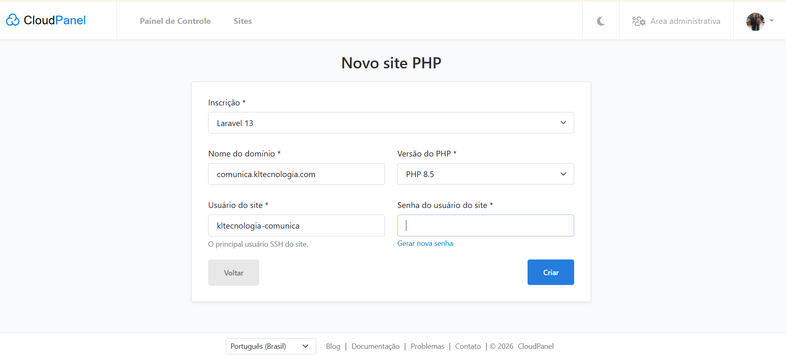
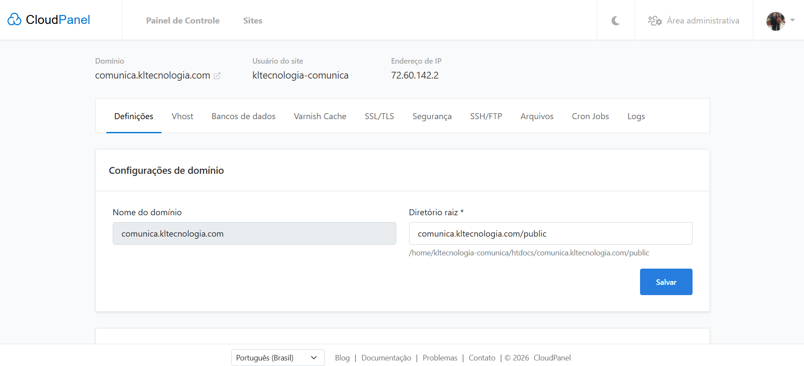
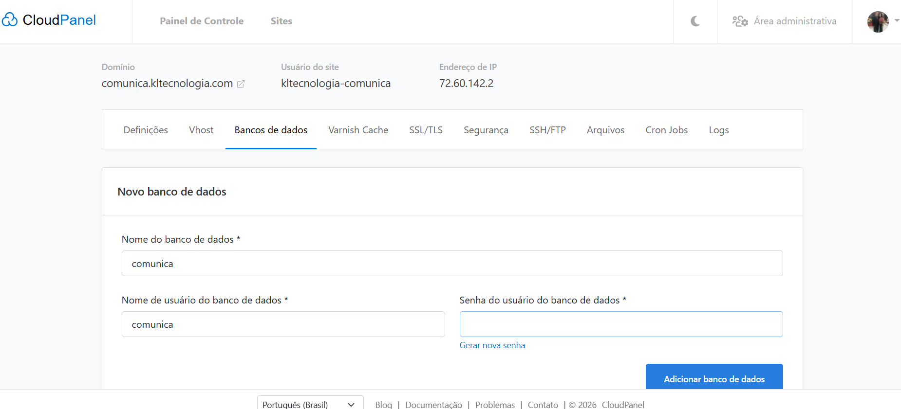

# Instalação do Comunica — VPS Hostinger com CloudPanel

Manual para o código do repositório [rayhenrique/comunica](https://github.com/rayhenrique/comunica). Desenvolvimento: [KL Tecnologia](https://kltecnologia.com).

## 1. Ambiente apresentado nas imagens

| Item | Valor observado |
| --- | --- |
| Domínio | comunica.kltecnologia.com |
| IP da VPS | 72.60.142.2 |
| Usuário Linux do site | kltecnologia-comunica |
| Aplicação do CloudPanel | Laravel 13 |
| PHP | 8.5 |
| Raiz pública | /home/kltecnologia-comunica/htdocs/comunica.kltecnologia.com/public |
| Banco e usuário MySQL propostos | comunica / comunica |

As imagens comprovam os campos apresentados, não a conclusão de criação, a existência do banco ou a propagação do DNS. Confirme os valores no seu painel. Senhas de SSH, banco, CloudPanel e aplicação são diferentes; escolha senhas fortes e mantenha-as fora do Git.

Este manual não executa instalação na VPS. Os comandos abaixo são para Linux na VPS; não os execute no PowerShell local. Faça snapshot/backup antes de modificar um servidor com dados.

## 2. CloudPanel e DNS

Se CloudPanel já está instalado, continue no passo 3. Para uma VPS nova, a Hostinger oferece o template Ubuntu com CloudPanel. Selecionar/reinstalar um template em servidor existente pode apagar dados: não faça isso para instalar somente o Comunica. Acesso do painel: `https://72.60.142.2:8443`, confirmando o IP em seu hPanel. [Orientação oficial Hostinger](https://www.hostinger.com/support/8794480-how-to-use-the-cloudpanel-vps-template-at-hostinger/).

No provedor DNS do domínio, configure um registro **A**, nome `comunica`, destino `72.60.142.2`. Confira resolução com `dig +short comunica.kltecnologia.com`. Corrija um registro AAAA apenas se ele apontar para outro servidor. Mantenha portas 80/443 acessíveis para o site; restrinja painel 8443 e SSH a acessos administrativos. Não publique a porta MySQL.

## 3. Criar o site PHP

No CloudPanel: **Sites → Adicionar site → Criar site PHP**. Use Laravel 13, domínio e usuário conforme a tabela e PHP 8.5. A senha desta tela pertence ao usuário Linux/SSH do site. Se o site já existe, confira suas configurações; não o recrie. [Guia oficial Laravel no CloudPanel](https://www.cloudpanel.io/docs/v2/php/applications/laravel/).



Em **Definições → Diretório raiz**, use `comunica.kltecnologia.com/public`. O caminho completo deve coincidir com a tabela. Use o template Vhost Laravel existente, que encaminha URLs para public/index.php; não substitua por configuração de site estático. [Configuração oficial de diretório raiz](https://www.cloudpanel.io/docs/v2/frontend-area/settings/).



## 4. Banco de dados

Em **Bancos de dados → Adicionar banco de dados**, crie o banco `comunica`, usuário `comunica` e uma senha forte. Se já existirem, confira as credenciais e preserve dados. O formulário da imagem está em preenchimento: confirme a criação no painel antes de prosseguir. [Documentação oficial de bancos](https://www.cloudpanel.io/docs/v2/frontend-area/databases/).



Use MySQL 8.0+ conforme o schema do projeto; confira `SELECT VERSION()` pelo painel/MySQL. Não use root com senha vazia na VPS. A senha escolhida será colocada somente no .env do servidor.

## 5. Acesso e código

Conecte como usuário do site, não execute Composer/npm como root:

```bash
ssh kltecnologia-comunica@72.60.142.2
cd /home/kltecnologia-comunica/htdocs
pwd
ls -la comunica.kltecnologia.com
```

O destino do clone deve estar ausente ou vazio. Se o CloudPanel criou um diretório com página inicial, inspecione-o e, somente se for a pasta inicial sem dados, renomeie para um nome de backup ainda não existente:

```bash
test ! -e comunica.kltecnologia.com-inicial-backup && mv comunica.kltecnologia.com comunica.kltecnologia.com-inicial-backup
git clone https://github.com/rayhenrique/comunica.git comunica.kltecnologia.com
cd comunica.kltecnologia.com
git log -1 --oneline
```

Não aplique esse mv a uma instalação ativa. Se a aplicação já está instalada, siga a seção de atualização. O crédito/Sobre só estará disponível após esta entrega ser publicada no GitHub; confira o commit desejado antes de instalar. Para fixar uma versão validada, use uma tag que realmente exista em `git tag --list`, ou um SHA publicado. Não use create-project: ele criaria outro Laravel sem o código do Comunica.

Confira ferramentas e extensões:

```bash
php8.5 -v
php8.5 -m
command -v composer
node -v
npm -v
git --version
```

Use Composer 2 e Node 24/npm compatível com o lockfile. Se Node não estiver disponível para o usuário do site, configure conforme [guia Node do CloudPanel](https://www.cloudpanel.io/docs/v2/php/guides/nodejs/) ou compile assets em ambiente de build equivalente e envie public/build. Node só é necessário para compilar, não para servir a aplicação.

```bash
php8.5 /usr/local/bin/composer install --no-dev --prefer-dist --optimize-autoloader --no-interaction
php8.5 /usr/local/bin/composer check-platform-reqs --no-dev
npm ci
npm run design:check
npm run design:test
npm run build
test -f public/build/manifest.json
test ! -f public/hot
```

Se Composer estiver em outro caminho, substitua /usr/local/bin/composer pelo caminho confirmado. Não ignore platform requirements. A instalação exige as extensões indicadas pelo Composer; confira também pdo_mysql. public/hot não deve apontar para o Vite local: não envie esse arquivo. Se existe em uma instalação anterior, inspecione-o e remova somente esse arquivo antes de servir assets compilados.

## 6. Ambiente de produção

Somente na primeira instalação, sem .env existente:

```bash
cp .env.example .env
chmod 600 .env
nano .env
```

Configure, preservando as demais entradas necessárias:

```dotenv
APP_NAME=Comunica
APP_ENV=production
APP_DEBUG=false
APP_URL=https://comunica.kltecnologia.com
APP_LOCALE=pt_BR
APP_FALLBACK_LOCALE=pt_BR
APP_FAKER_LOCALE=pt_BR
APP_TIMEZONE=America/Sao_Paulo
DB_CONNECTION=mysql
DB_HOST=127.0.0.1
DB_PORT=3306
DB_DATABASE=comunica
DB_USERNAME=comunica
DB_PASSWORD="SUBSTITUA_PELA_SENHA_DO_BANCO"
SESSION_DRIVER=file
SESSION_SECURE_COOKIE=true
CACHE_STORE=file
QUEUE_CONNECTION=sync
LOG_LEVEL=warning
```

Use aspas apropriadas na senha se ela contém espaços ou caracteres especiais; nunca copie a senha fictícia acima. APP_TIMEZONE é configuração inicial, não uma alteração do prazo de 48 horas. APP_KEY deve ser gerada apenas na primeira instalação:

```bash
php8.5 artisan key:generate --force
php8.5 artisan config:clear
```

Em atualizações/importação de uma instalação existente, preserve a APP_KEY original. Não importe o .env local com APP_DEBUG=true ou credenciais de root. O processo PHP-FPM deve usar o usuário do site para ler o .env protegido; confirme no painel se houver erro de permissão.

## 7. Permissões e migrations

Executando como usuário do site que é proprietário dos arquivos:

```bash
chmod -R u+rwX storage bootstrap/cache
php8.5 artisan migrate:status
php8.5 artisan migrate --force
```

Confira a propriedade antes de alterar permissões; não use chmod 777. Não execute migrate:fresh/reset ou db:seed na base institucional. Os seeders são demonstrativos, com pautas fictícias e contas example.test.

Se está migrando dados do Windows, exporte/importa o banco com backup e preservação de hashes, IDs, chaves e datas; não rode seeder por cima para criar contas. Se a base já contém usuários válidos, pule o cadastro inicial abaixo.

## 8. Primeiro usuário institucional

O MVP não oferece cadastro público. `comunica:password` é exclusivo de local/testing: não mude APP_ENV para contornar isso. Para provisionar uma conta existente/inicial, um administrador do servidor pode usar Tinker com dados reais e senha oculta. Tinker pertence às dependências de produção deste projeto.

```bash
php8.5 artisan tinker
```

No console PHP, execute **uma linha por vez**, substituindo nome, e-mail e setor. Use um e-mail ainda não cadastrado; se já existir, pare e use o procedimento de suporte responsável, sem sobrescrever contas inadvertidamente:

```php
$email = 'SUBSTITUA_PELO_EMAIL_INSTITUCIONAL';
filter_var($email, FILTER_VALIDATE_EMAIL) ?: throw new RuntimeException('Informe um e-mail válido.');
App\Models\User::where('email', $email)->exists() && throw new RuntimeException('E-mail já cadastrado; preserve a conta existente.');
$senha = Laravel\Prompts\password('Nova senha (mínimo 12 caracteres)', required: true, validate: fn ($valor) => mb_strlen($valor) < 12 ? 'Use pelo menos 12 caracteres.' : null); null;
$confirmacao = Laravel\Prompts\password('Confirme a senha', required: true); null;
$senha === $confirmacao ?: throw new RuntimeException('As senhas não correspondem.');
$usuario = new App\Models\User();
$usuario->name = 'SUBSTITUA_PELO_NOME';
$usuario->email = $email;
$usuario->department = 'Comunicação';
$usuario->role = 'communication_admin';
$usuario->password = $senha; null;
$usuario->save();
unset($senha, $confirmacao, $usuario);
exit
```

Mantenha o `null;` no fim das três linhas de senha: ele impede que o Tinker exiba o resultado da expressão. Não digite a senha como string literal no console; o prompt oculta a entrada e o cast do Model aplica hashing. Não confirme/imprima as variáveis de senha. Acesso CLI administrativo autoriza este provisionamento, não um novo cadastro na interface. Para coordenadores, repita com dados reais e role `coordinator`. Se uma linha lançar erro, interrompa o procedimento e corrija antes de salvar. Este exemplo não foi executado na sua VPS.

## 9. HTTPS e publicação

Com o DNS correto, em **SSL/TLS → Ações → Novo certificado Let's Encrypt**, informe o domínio e crie/instale. Confira HTTPS antes de liberar login; habilite redirecionamento HTTP→HTTPS no Vhost/configuração do painel e mantenha APP_URL em HTTPS. [Certificados no CloudPanel](https://www.cloudpanel.io/docs/v2/frontend-area/tls/).

Se usa Cloudflare, configure comunicação segura até a origem e evite modo Flexible, que pode causar loops/URLs inconsistentes. Não habilite cache integral de páginas autenticadas ou requisições Livewire; deixe Varnish/PageSpeed desativados até validar a aplicação.

Na pasta do projeto:

```bash
php8.5 artisan config:cache
php8.5 artisan route:cache
php8.5 artisan view:cache
```

O CloudPanel/PHP-FPM serve public/index.php. Não use artisan serve, npm run dev ou PM2 para manter este site PHP em produção. A versão atual usa filas síncronas e não tem tarefas agendadas de domínio: não é necessário adicionar worker ou cron vazio.

## 10. Conferência final

```bash
curl -I https://comunica.kltecnologia.com/calendario
curl -I https://comunica.kltecnologia.com/sobre
```

Confirme HTTP 200, HTTPS válido, calendário público, página Sobre e crédito KL Tecnologia. Teste login dos dois perfis, criação válida/inválida, isolamento, cancelamento pendente e decisões com justificativa. Confira mobile/tablet/desktop, CSS/JS sem 404, envio Livewire sem 419 e ausência de detalhes de erro/segredos. O check /up confirma processo, não substitui teste do banco e fluxos.

Teste que /.env não é acessível. O segredo do ambiente só existe fora da raiz pública; em caso de exposição, bloqueie o acesso e troque os segredos comprometidos. O domínio/IP das imagens não foi acessado para validar esta implantação.

## 11. Atualização e backup

Faça backup do banco e do .env, fora de public e do Git, antes de atualizar. O CloudPanel dispõe de recursos de banco/backup; confirme retenção e faça um teste de restauração. Git versiona código, não dados.

Com o projeto existente, árvore Git limpa e acesso SSH como usuário do site:

```bash
git status --short
git rev-parse HEAD
php8.5 artisan down
git fetch origin
git merge --ff-only origin/main
php8.5 /usr/local/bin/composer install --no-dev --prefer-dist --optimize-autoloader --no-interaction
npm ci
npm run design:check
npm run design:test
npm run build
php8.5 artisan config:clear
php8.5 artisan migrate --force
php8.5 artisan config:cache
php8.5 artisan route:cache
php8.5 artisan view:cache
php8.5 artisan up
```

Execute cada comando e pare se houver falha. Enquanto a correção não estiver validada, preserve manutenção; para abortar sem alteração irreversível, restaure a versão revisada e use artisan up somente depois de verificar. Um retorno de código não reverte migrations: rollback de dados exige backup/plano específico. Preserve .env/APP_KEY. Reinicie PHP-FPM pelo CloudPanel se o OPcache mantiver código antigo; não reinicie serviços de outros sites sem necessidade.

## 12. Diagnóstico

| Sintoma | Verificação |
| --- | --- |
| Erro 500 | storage/logs/laravel.log e Logs do site; extensões, .env, permissões, caches |
| SQLSTATE/acesso negado | Nome/usuário/senha reais do CloudPanel e conexão MySQL |
| CSS/JS ausentes | public/build/manifest.json, APP_URL, ausência de public/hot e raiz /public |
| URLs internas 404 | Template Laravel no Vhost, diretório raiz e cache de rotas |
| Erro 419 | HTTPS, cookie seguro, host consistente, sessão gravável e APP_KEY preservada |
| Redirecionamento em loop | Regras HTTPS/proxy e configuração Cloudflare |
| Não consigo entrar | Conta institucional existente, role correta e senha definida pelo administrador |

Não habilite APP_DEBUG=true publicamente para diagnosticar; leia os logs pelo SSH/painel. Não envie logs com credenciais ao suporte. O manual foi revisado contra o código e fontes oficiais; instalação real, firewall, DNS, certificados e restauração precisam ser validados no servidor.
